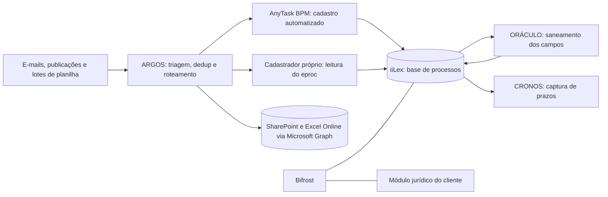

<div align="center">


# João Schwarzbach

**Software Engineer · Automação & Legaltech** · Porto Alegre, RS

[](https://www.linkedin.com/in/jo%C3%A3o-schwarzbach-060667290/)
[](mailto:joaolbschwarzbach@gmail.com)


</div>

```console
joao@portoalegre:~$ whoami
Software Engineer focado em automação com Python no setor jurídico.
Construo e mantenho robôs em produção que leem publicações e e-mails,
cadastram processos e conversam com iiLex, AnyTask, SharePoint e
Microsoft Graph — com LGPD, trilha de auditoria e revisão humana como
parte da definição de pronto.

joao@portoalegre:~$ git log --oneline carreira
HEAD     05/2026 → hoje    Desenvolvedor de Automação Jr · Ramos Advogados
a3f9c21  2023 → 2025       Analista de Sistemas e Operações · Daisy Vargas Ferragens
7be04d8  2021 → 2023       Jovem Aprendiz · Caixa Econômica Federal
```

## `$ stack --list`

<div align="center">


<br/>


</div>

## `$ cat arquitetura.md`

Como os robôs conversam no dia a dia de um escritório de advocacia:



## `$ ls projetos/`

<table>
<tr>
<td width="50%" valign="top">

### ARGOS


Suíte de 6 módulos que cruza e-mail, publicações, iiLex e SharePoint. Sincronização horária com Excel Online via **Microsoft Graph (OAuth 2.0)**, deduplicação entre fontes e trilha de auditoria de cada processo que entra.

`Python` `Microsoft Graph` `SharePoint` `Task Scheduler`

</td>
<td width="50%" valign="top">

### ORÁCULO


Sistema web interno que **saneia automaticamente os campos** de uma base de processos, 100% automático, publicado na intranet. Nasceu como app PySide6 (~3.600 linhas) com gráficos Power BI e relatórios HTML.

`Python` `PySide6` `Power BI` `pandas` `HTML/CSS`

</td>
</tr>
<tr>
<td width="50%" valign="top">

### Bifrost


Pipeline que integra iiLex, AnyTask e o módulo jurídico de um cliente: anti-duplicação, roteamento por regra e conciliação de abas de auditoria — fluxos que antes eram manuais.

`Python` `APIs REST` `openpyxl`

</td>
<td width="50%" valign="top">

### AnyTask BPM


Robô que cadastra processos na base do iiLex: regras de leitura, montagem de lote e confirmação de cada cadastro.

`Python` `Selenium` `RPA`

</td>
</tr>
<tr>
<td width="50%" valign="top">

### CRONOS


Captura de prazos de publicações judiciais, auditado para corrigir durações, datas de julgamento e papel das partes. **Prazo é código crítico.**

`Python` `regex` `SQLite`

</td>
<td width="50%" valign="top">

### Classificador de publicações


Motor com **~60 categorias** para publicações judiciais. Quando falta dado, não chuta: manda para revisão humana.

`Python` `pandas` `regex`

</td>
</tr>
<tr>
<td width="50%" valign="top">

### BuscaJus


Lê processos e decodifica a numeração CNJ em **92 combinações de tribunais**, com consulta O(1) em JSON.

`Python` `Selenium` `JSON`

</td>
<td width="50%" valign="top">

### ÍRIS


Ferramenta legaltech de código fechado: reconciliação de publicações do DJEN por OAB, **sem guardar dados do usuário**.

`Python` `FastAPI`

</td>
</tr>
<tr>
<td width="50%" valign="top">

### Infraestrutura de automação


Host Hyper-V com 4 VMs dedicadas aos robôs e uma VM com GPU para **IA local**, sem enviar dados de clientes a terceiros.

`Hyper-V` `Windows` `Entra ID`

</td>
<td width="50%" valign="top">

### Sistema NFE · Daisy Vargas Ferragens


Gestão fiscal desktop para uma ferragem que atende dezenas de hospitais: importa XMLs da SEFAZ, casa Ordem de Compra por padrão de cada cliente, controla estoque e entrega dashboard executivo e inteligência fiscal (NCM, CFOP, custo médio).

`Python` `PySide6` `SQLite` `lxml`

</td>
</tr>
</table>

<sub>E mais: Vigia CEJUSC (monitoramento automatizado) e o gerador de assinaturas de e-mail da intranet.</sub>

## `$ ./metricas --resumo`

| | |
|---|---|
| **12.780** bloqueios por dia investigados num rate limit | 73% vinham de uma automação de terceiros |
| **18** gargalos de produção auditados | foco em LGPD e revisão humana |
| **~60** categorias no classificador de publicações | com fila de revisão quando falta dado |
| **92** combinações de tribunais na numeração CNJ | consulta O(1) |
| **10 mil+** NF-e processadas no Sistema NFE | 22 mil+ itens, 90+ CNPJs |

## `$ cat principios.txt`

> **LGPD por padrão** — coleta mínima, dado sensível fora de log e anonimização antes de qualquer envio a terceiros.
>
> **Rastreabilidade** — toda ação relevante registra quem, quando e com base em qual fonte.
>
> **Prazo é código crítico** — regra jurídica com teste, base legal documentada e memória de cálculo auditável.

<div align="center">
<sub>joao@portoalegre:~/github · feito com Python, café e revisão humana</sub>
</div>
